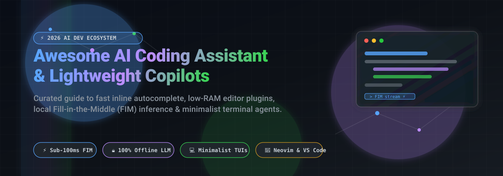

# Awesome-AI-Coding-Assistant-Lightweight-Copilot

  

  

### 🚀 Top AI Coding Assistant & Lightweight Copilot Ecosystem

**A Curated Collection of High-Speed SaaS Solutions & Low-Overhead Open-Source GitHub Projects**

*Engineered for Sub-Second Inline Code Completion (FIM), Minimal RAM Footprint, Privacy-First Local LLM Inference, and Fast Terminal AI Agents.*

📅 **Last updated: November 2026**

---

## 📑 Table of Contents

- [🔍 Sector Overview & Market Dynamics](#-sector-overview--market-dynamics)
- [☁️ SaaS & Hosted Platforms](#️-saas--hosted-platforms)
- [🐙 Open-Source GitHub Projects](#-open-source-github-projects)
- [🧠 Recommended Local Inference Backends & Models](#-recommended-local-inference-backends--models)
- [🤝 How to Contribute](#-how-to-contribute)
- [💖 Support & Community](#-support--community)
- [📊 Star History](#-star-history)
- [⚠️ Disclaimer](#️-disclaimer)

---

## 🔍 Sector Overview & Market Dynamics

The AI coding assistant and developer tooling sector is undergoing explosive growth, expanding from an estimated **$4–5 billion in 2024** to over **$9–11 billion by 2026**, with long-term compound annual growth rates (CAGR) of ~25–30% projecting the market past **$30–40 billion** by the early 2030s.

Rather than concentrating into a winner-take-all monopoly, the sector exhibits **moderate-to-high market fragmentation**. Development dynamics are driven by distinct developer demands:
- **Cloud Hyperscalers:** Microsoft (GitHub Copilot) and Amazon (Amazon Q Developer) deliver broad ecosystem reach and integrated enterprise compliance.
- **AI-Native Next-Gen IDEs:** Fast-moving innovators like Cursor (Anysphere) and Windsurf (Cognition AI) push agentic multi-file workflows and whole-codebase reasoning.
- **Enterprise-Governed Deployments:** Specialized tools like Tabnine and Sourcegraph Cody cater to zero-data-retention, air-gapped environments, and massive monorepos.
- **Lightweight & Local Open-Source Movement:** Independent developers increasingly favor minimalist editor plugins (Neovim, VS Code) paired with local inference engines (Ollama, llama.cpp) and open-weight FIM models (Qwen2.5-Coder, StarCoder2) for sub-100ms latency, zero telemetry, and complete code privacy.

---

## ☁️ SaaS & Hosted Platforms

Below is a breakdown of top commercial AI coding copilot platforms, sorted by estimated company size and valuation:

| Platform | Company Valuation / Revenue Size | Starting Paid Pricing | Free Tier / Free Trial Limits | Description |
| :--- | :--- | :--- | :--- | :--- |
| **[Amazon Q Developer](https://amazon.com)** | **$2.3T+ Market Cap** (Amazon / AWS; AWS ~$105B+ ARR) | **$19/user/month** (Pro Tier) | **Free tier permanently available**: 50 agentic chat/CLI requests/month, 50 security scans/month, 1,000 lines of Java code transformation/month. | Cloud AI coding companion providing inline suggestions, IDE chat, security vulnerability scanning, and AWS cloud management. |
| **[GitHub Copilot](https://github.com)** | **$3.1T+ Market Cap** (Parent: Microsoft; GitHub Copilot ~$300M+ ARR) | **$10/month** (Copilot Pro) | **Free tier permanently available**: 2,000 code completions/month and 50 chat/agent messages per month across supported IDEs. | Industry-standard AI pair programmer offering low-latency inline autocomplete, next-edit suggestions, and broad IDE support. |
| **[JetBrains AI Assistant](https://jetbrains.com)** | **$5B–$10B Valuation** (~$700M+ ARR; bootstrapped & profitable) | **$10/month** (AI Pro individual; or $100/year) | **30-day free trial** of AI Pro with promotional cloud AI credits; transitions to permanent **AI Free tier** (basic local completions + 3 cloud credits per 30 days). | Natively integrated AI code completion, inline refactoring, and commit-message assistant built directly into IntelliJ, PyCharm, and JetBrains IDEs. |
| **[Cursor](https://cursor.com)** | **$29.3B Valuation** (Anysphere; Series D; ~$1B+ ARR) | **$8/month** (Plus tier; Pro at $20/month) | **Free Hobby tier permanently available**: Limited Tab autocomplete (~2,000 completions/month) and limited slow queue requests/month (no expiration, no credit card required). | AI-native code editor forked from VS Code featuring predictive Tab autocomplete, instant diff previews, codebase indexing, and multi-file agentic editing. |
| **[Windsurf (formerly Codeium)](https://windsurf.com)** | **$10.2B+ Valuation** (Acquired by Cognition AI; pre-deal ~$82M ARR) | **$20/month** (Pro Tier) | **Free tier permanently available**: Unlimited Tab completions & inline edits, plus a light rolling daily/weekly usage quota for autonomous agents. | Agentic AI IDE and extension suite featuring fast Supercomplete inline suggestions, Cascade multi-step flows, and multi-editor plugin support. |
| **[Sourcegraph Cody](https://sourcegraph.com)** | **$2.6B Valuation** (Series D; ~$35M–$50M ARR) | **$16,000/year minimum contract** (~$50–$59/user/month effective) | **No individual free tier or trial** (Cody Free & Pro retired July 2025; available exclusively via enterprise contracts with tailored proof-of-concept evaluations). | Context-aware AI coding assistant leveraging Sourcegraph's code graph for deep codebase retrieval, inline edits, and multi-repo search. |
| **[Tabnine](https://tabnine.com)** | **~$100M Valuation** (Acquired by Tricentis; ~$10M–$25M ARR) | **$39/user/month** (Code Assistant, billed annually) | **14-day free trial** of the full Code Assistant plan; standalone free tier retired in favor of team and enterprise evaluations. | Enterprise-grade AI code completion and chat assistant offering local/cloud hybrid models, zero-data-retention privacy, and air-gapped deployments. |
| **[Supermaven](https://supermaven.com)** | **$12M Raised** (Acquired by Cursor/Anysphere; tech integrated into Cursor) | **$10/month** (Pro Tier) | **Free tier permanently available**: Fast inline completions with standard context window and 7-day data retention (excludes 1M-token Babble context & chat credits). | Ultra-low-latency AI code completion platform built around a 1-million-token context window (Babble) for near-instantaneous inline suggestions. |
| **[Continue.dev Hub (Cloud)](https://continue.dev)** | **$5.6M Raised** (Seed; team acquired by Cursor/Anysphere) | **$10/developer/month** (Team Tier) | **Free Solo tier permanently available**: $0/developer/month for full open-source extension using BYOK (Bring Your Own Key) or unlimited local models (Ollama). | Cloud governance and configuration layer for the open-source Continue extension enabling shared team assistants, model routing, and MCP setups. |

---

## 🐙 Open-Source GitHub Projects

Curated list of open-source coding copilots, minimalist terminal assistants, and lightweight editor extensions, **sorted in descending order by GitHub_Stars**:

- **[OpenCode (`anomalyco/opencode`)](https://github.com/anomalyco/opencode)**   
  ⚡ Modern, blazingly fast open-source (`MIT`) terminal-native AI coding assistant featuring a crisp TUI, LSP diagnostics awareness, and multi-provider local/cloud LLM support.

- **[Ollama (`ollama/ollama`)](https://github.com/ollama/ollama)**   
  🦙 The de facto open-source (`MIT`) runtime to get up and running with local LLMs (Qwen2.5-Coder, DeepSeek-Coder, Llama) with built-in OpenAI-compatible API endpoints for editor plugins.

- **[llama.cpp (`ggml-org/llama.cpp`)](https://github.com/ggml-org/llama.cpp)**   
  ⚙️ Highly optimized, dependency-free C/C++ inference engine delivering ultra-fast local CPU/GPU token generation and sub-50ms FIM completions.

- **[Zed Editor (`zed-industries/zed`)](https://github.com/zed-industries/zed)**   
  ⚡ Ultra-fast, GPU-accelerated open-source (`GPL-3.0` / `Apache-2.0`) Rust code editor featuring native Edit Prediction (`Zeta` open model) and lightweight inline AI assistance.

- **[Cline (`cline/cline`)](https://github.com/cline/cline)**   
  🤖 Autonomous open-source (`Apache-2.0`) coding agent for VS Code with direct file system access, terminal execution, MCP tool support, and human-in-the-loop checkpoints.

- **[Aider (`Aider-AI/aider`)](https://github.com/Aider-AI/aider)**   
  💻 Pair-programming terminal AI tool (`Apache-2.0`) that edits code directly in local Git repositories, runs tests, and automatically creates clear Git commit messages.

- **[CopilotKit (`CopilotKit/CopilotKit`)](https://github.com/CopilotKit/CopilotKit)**   
  🧩 Open-source (`MIT`) framework for building custom, highly integrated in-app AI copilots, inline text completion components, and autonomous AI agents.

- **[Continue (`continuedev/continue`)](https://github.com/continuedev/continue)**   
  🛠️ Leading open-source (`Apache-2.0`) modular AI code assistant extension for VS Code and JetBrains supporting custom Tab autocomplete, inline edits, and any local or cloud model.

- **[Tabby (`TabbyML/tabby`)](https://github.com/TabbyML/tabby)**   
  🐱 Self-hosted open-source (`Apache-2.0`) AI coding assistant written in Rust delivering sub-second Fill-in-the-Middle (FIM) autocomplete and lightweight extensions for VS Code, Vim/Neovim, and IntelliJ.

- **[crush (`charmbracelet/crush`)](https://github.com/charmbracelet/crush)**   
  🧁 Glamorous, lightweight open-source (`FSL-1.1-MIT`) terminal coding copilot built by Charm combining a fast Lip Gloss TUI with LSP integration, MCP tools, and model switching.

- **[Void (`voideditor/void`)](https://github.com/voideditor/void)**   
  🌌 Open-source (`Apache-2.0`) lightweight alternative to Cursor built on VS Code providing inline diff autocomplete, local indexing, and direct BYOK/Ollama connections.

- **[Roo Code / Roo-Cline (`RooVetGit/Roo-Cline`)](https://github.com/RooVetGit/Roo-Cline)**   
  🦘 Advanced open-source (`Apache-2.0`) autonomous coding agent fork of Cline featuring custom system prompts, multi-mode personas (Architect, Code, Ask), and checkpoint diffs.

- **[Avante.nvim (`yetone/avante.nvim`)](https://github.com/yetone/avante.nvim)**   
  ✨ Open-source (`Apache-2.0`) Neovim plugin delivering Cursor-style inline diff previews and fast agentic code edits inside a native terminal editor footprint.

- **[Qwen2.5-Coder (`QwenLM/Qwen2.5-Coder`)](https://github.com/QwenLM/Qwen2.5-Coder)**   
  🏆 Premier open-source coding model series (0.5B to 32B) optimized for high-speed Fill-in-the-Middle (FIM) code completion and competitive with top proprietary models.

- **[FauxPilot (`fauxpilot/fauxpilot`)](https://github.com/fauxpilot/fauxpilot)**   
  ✈️ Lightweight open-source (`Apache-2.0`) GitHub Copilot API-compatible local server backend powered by Triton/FasterTransformer.

- **[libracoder/kiri (`libracoder/kiri`)](https://github.com/libracoder/kiri)**   
  🗡️ Lightweight open-source AI coding assistant and minimalist copilot engineered for fast, low-overhead code generation, editing, and streamlined developer workflows.

- **[AIChat (`sigoden/aichat`)](https://github.com/sigoden/aichat)**   
  💬 All-in-one lightweight CLI companion written in Rust supporting shell assistant workflows, code refactoring pipes, and local/remote LLM routing.

- **[bloop (`BloopAI/bloop`)](https://github.com/BloopAI/bloop)**   
  🔎 Fast open-source (`Rust`) code search and navigation engine leveraging local LLMs and semantic embeddings for codebase understanding.

- **[CodeCompanion.nvim (`olimorris/codecompanion.nvim`)](https://github.com/olimorris/codecompanion.nvim)**   
  🤝 Clean, extensible open-source (`MIT`) AI coding plugin for Neovim providing inline code transformations, slash commands, and lightweight adapters for local and cloud models.

- **[codeium.vim (`Exafunction/codeium.vim`)](https://github.com/Exafunction/codeium.vim)**   
  🚀 Free and minimalist open-source (`MIT`) Vim/Neovim plugin delivering fast inline AI code completion directly in the editor buffer.

- **[Mods (`charmbracelet/mods`)](https://github.com/charmbracelet/mods)**   
  🔮 AI for the command line built by Charm designed for piping stdin, formatting terminal code output, and automating shell workflows.

- **[Twinny (`twinnydotdev/twinny`)](https://github.com/twinnydotdev/twinny)**   
  ♊ Zero-telemetry, lightweight open-source (`MIT`) VS Code extension built specifically for local Ollama, llama.cpp, and LM Studio inference with fast FIM autocomplete and chat.

- **[Refact.ai (`smallcloudai/refact`)](https://github.com/smallcloudai/refact)**   
  🔧 Self-hostable open-source (`BSD-3-Clause`) AI coding engine offering AST-aware FIM code completion, local fine-tuning, and lightweight IDE plugins.

- **[llama.vim (`ggml-org/llama.vim`)](https://github.com/ggml-org/llama.vim)**   
  🦙 Official ultra-lightweight open-source (`MIT`) Vim and Neovim plugin from `llama.cpp` providing fast, local GPU-accelerated inline code completion with automatic context caching.

- **[StarCoder2 (`bigcode-project/starcoder2`)](https://github.com/bigcode-project/starcoder2)**   
  ⭐ Open-access, transparently trained code LLMs (3B, 7B, 15B) built by BigCode with high-efficiency Fill-in-the-Middle capabilities.

- **[gen.nvim (`David-Kunz/gen.nvim`)](https://github.com/David-Kunz/gen.nvim)**   
  ⚡ Minimalist Neovim plugin (`MIT`) to generate text and code using local Ollama models with zero external dependencies.

- **[minuet-ai.nvim (`milanglacier/minuet-ai.nvim`)](https://github.com/milanglacier/minuet-ai.nvim)**   
  🎵 Minimalist, snappy open-source (`MIT`) Neovim AI completion plugin supporting `nvim-cmp`, `blink.cmp`, and virtual-text ghost suggestions across Ollama, llama.cpp, OpenAI, and Claude.

- **[gp.nvim (`Robitx/gp.nvim`)](https://github.com/Robitx/gp.nvim)**   
  🎯 Zero-bloat Neovim AI plugin (`MIT`) for session chats, inline code generation, and multi-provider model switching without heavy frameworks.

- **[vim-ai (`madox2/vim-ai`)](https://github.com/madox2/vim-ai)**   
  📝 Simple, lightweight AI companion for Vim and Neovim providing clean interactive chat and inline code editing.

- **[llm.nvim (`huggingface/llm.nvim`)](https://github.com/huggingface/llm.nvim)**   
  🤗 Lightweight open-source (`Apache-2.0`) Neovim plugin from Hugging Face offering ghost-text inline code completion backed by local `ollama`/`llama.cpp` or Inference Endpoints.

- **[ellama (`s-kostyaev/ellama`)](https://github.com/s-kostyaev/ellama)**   
  🐂 Lightweight GNU Emacs package (`GPL-3.0`) for interacting with local LLMs (Ollama) for code completion, translation, and chat.

---

## 🧠 Recommended Local Inference Backends & Models

For developers looking to assemble a 100% offline, privacy-first, low-RAM coding copilot:

1. **Lightweight Editor / Client Plugin:**  
   - VS Code: **Twinny** or **Continue**
   - Neovim: **minuet-ai.nvim**, **avante.nvim**, or **CodeCompanion.nvim**
   - Terminal: **OpenCode**, **Aider**, or **crush**
2. **Local Inference Runtime:**  
   - **Ollama** (effortless setup, REST API) or **llama.cpp** (peak GPU/CPU efficiency & lowest RAM footprint)
3. **Small Open-Weight FIM Models:**  
   - **Qwen2.5-Coder-1.5B / 3B / 7B**: Sub-100ms inline Fill-in-the-Middle autocomplete
   - **StarCoder2-3B**: Ultra-lightweight coding companion for low-VRAM laptops

---

## 🤝 How to Contribute

Contributions are warmly welcomed! Help keep this curated list accurate and comprehensive:

1. 🍴 Fork the repository.
2. 📝 Add or update an entry in `README.md` maintaining proper markdown formatting, accurate links, and Stars_Badges.
3. 💡 Ensure descriptions remain concise, objective, and factual.
4. 🚀 Open a Pull Request detailing the changes and reason for inclusion.

---

## 💖 Support & Community

If you find this repository helpful, please consider showing your support:

- ⭐ **Star this repository** to help other developers discover it!
- 🍴 **Fork and contribute** new lightweight tools and benchmarks.
- 📢 **Share with your developer circles** and team members.
- ☕ **Sponsor this project / Buy a coffee**: Support ongoing curation and maintenance via the [GitHub Sponsors Dashboard](https://github.com/sponsors/ishandutta2007).

Thank you for being part of the open-source developer tooling movement! 🚀

---

## 📊 Star History

---

## ⚠️ Disclaimer

- This is a **community-curated** list — not exhaustive and not a commercial endorsement.
- Lightweight local FIM autocomplete models (1.5B–7B parameters) prioritize sub-200ms latency over deep multi-file architectural reasoning; consider pairing small FIM models for inline typing with larger reasoning models for complex refactoring.
- Always review AI-suggested code diffs for subtle bugs, security vulnerabilities, and license compliance before committing to production repositories.

---
